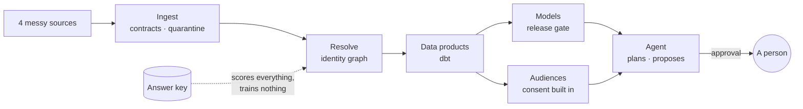

<h1 align="center">Plumbline</h1>

<p align="center"><b>Customer data that checks its own answers.</b><br>
Ingest · resolve · predict · act</p>

<p align="center">
<a href="https://github.com/AKilalours/plumbline/actions/workflows/tests.yml"></a>


</p>

<p align="center"><a href="docs/video/plumbline-demo.mp4"></a></p>

<table>
<tr>
<td width="50%"></td>
<td width="50%"></td>
</tr>
<tr>
<td align="center"><b>🧪 Break it, watch it heal</b><br><sub>the agent can't approve its own fix</sub></td>
<td align="center"><b>🚦 Models earn their release</b><br><sub>better, calibrated, fair across slices</sub></td>
</tr>
<tr>
<td width="50%"></td>
<td width="50%"></td>
</tr>
<tr>
<td align="center"><b>🛡️ English to SQL that can't leak</b><br><sub>secrets, contact data, writes: blocked</sub></td>
<td align="center"><b>🔍 Every score explains itself</b><br><sub>reasons add back up to the exact score</sub></td>
</tr>
</table>

<table>
<tr>
<td align="center"><h2>0.991</h2>identity F1<br><sub>exact matching: 0.927</sub></td>
<td align="center"><h2>0</h2>innocent people deleted<br><sub>at 1,000,000 people</sub></td>
<td align="center"><h2>100</h2>injected faults<br><sub>0 changes to the data</sub></td>
<td align="center"><h2>19/20</h2>right tool, agent<br><sub>keyword rules: 12/20</sub></td>
<td align="center"><h2>6 min</h2>whole pipeline<br><sub>100,000 people, 2 cores</sub></td>
</tr>
</table>



```bash
python -m venv .venv && source .venv/bin/activate
python -m pip install -e ".[dev,app]"
python -m streamlit run streamlit_app.py      # a live city in about a minute
```

<p align="center">
<b>Go deeper</b><br>
<a href="docs/details.md#results">📊 Results</a> ·
<a href="docs/details.md#identity-resolution-module-b">🧬 Identity</a> ·
<a href="docs/details.md#deletion-at-the-person-level">🗑️ Deletion</a> ·
<a href="docs/details.md#home-buyer-model-module-c">📈 Models</a> ·
<a href="docs/details.md#ai-measured">🤖 AI, measured</a> ·
<a href="docs/details.md#operations-agent-module-e">🛠️ Agent</a> ·
<a href="docs/details.md#scale">⚡ Scale</a> ·
<a href="docs/details.md#how-ingestion-works">🔁 Ingestion</a> ·
<a href="docs/role_map.md">🗺️ Role map</a>
</p>
