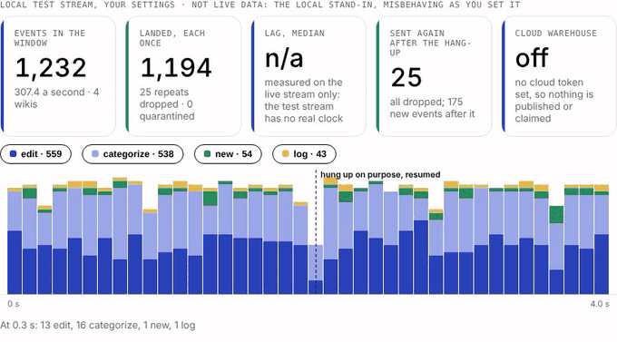
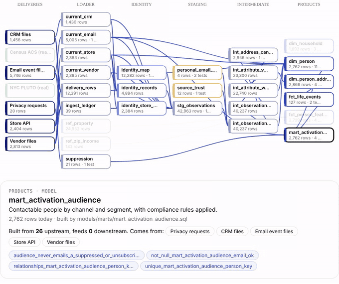
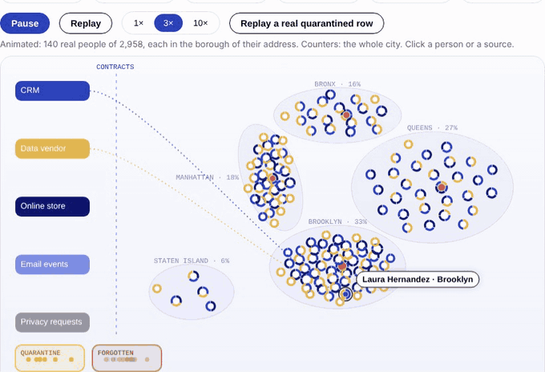
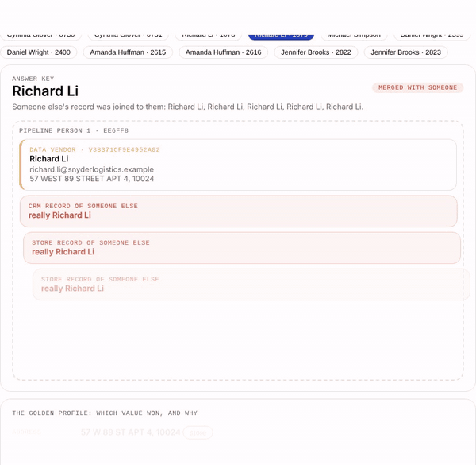
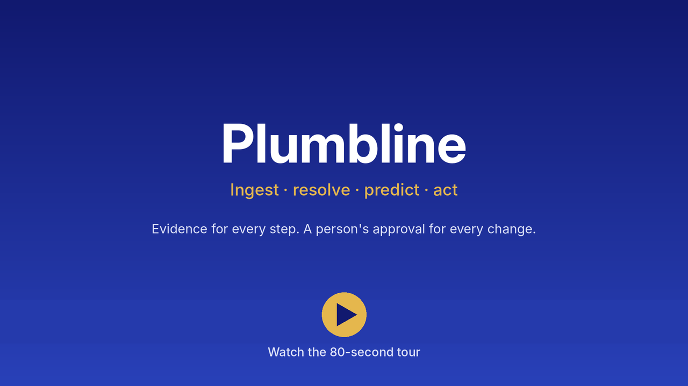
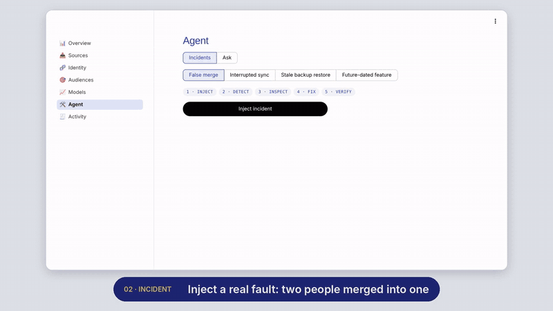
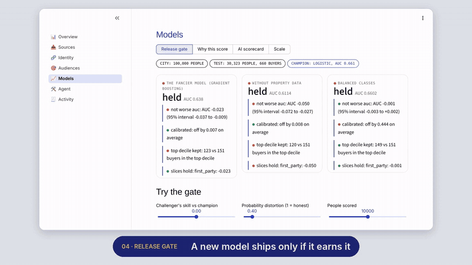
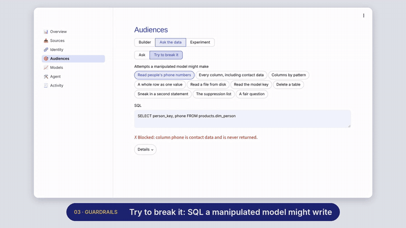
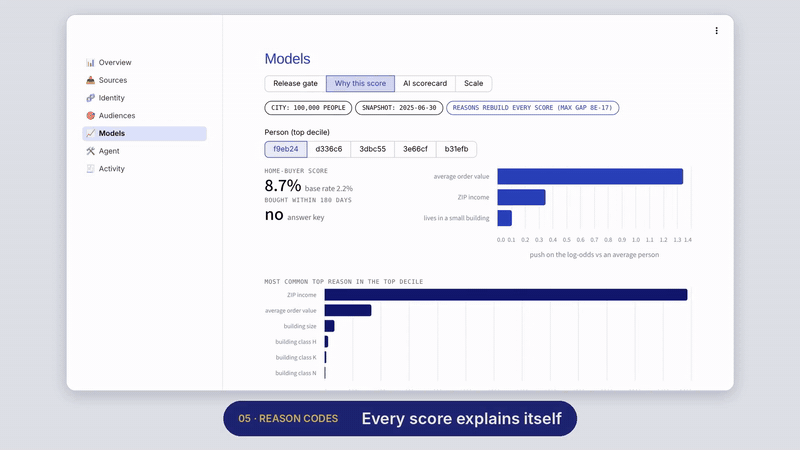
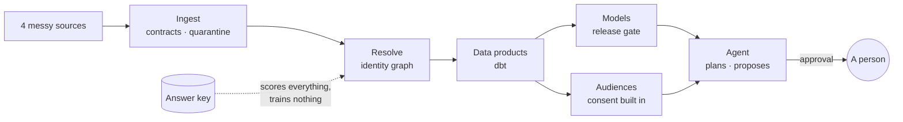

<h1 align="center">Plumbline</h1>

<p align="center"><b>Data ingestion that proves it is right.</b><br>
Real public feeds, a live stream, Kafka and a Postgres change log, loaded under reviewed contracts, every run on the record.</p>

<p align="center">
<a href="https://github.com/AKilalours/plumbline/actions/workflows/tests.yml"></a>
<a href="https://github.com/AKilalours/plumbline/actions/workflows/open_data.yml"></a>


</p>

<p align="center"><a href="https://minerva-plumbline.streamlit.app"><b>▶ Try the live app</b></a> · every button does real work<br>
<a href="https://minerva-plumbline.streamlit.app/try"><b>📤 Try it on your own files</b></a> · drop customer CSVs with any column names, get one clean customer list back (nothing is stored)</p>

<table>
<tr>
<td align="center"><h2>5</h2>kinds of source<br><sub>files · APIs · live stream · Kafka · Postgres CDC</sub></td>
<td align="center"><h2>0</h2>lost or doubled after a crash<br><sub>real Kafka and real Postgres, in CI</sub></td>
<td align="center"><h2>803,457</h2>rows a publisher reloaded<br><sub>skipped, recorded; the 2,438 real changes landed</sub></td>
<td align="center"><h2>3</h2>real incidents<br><sub>found, fixed at the root, written up</sub></td>
</tr>
</table>

### Real, every day

NYC Open Data permits and Wikimedia's live edit stream are synced on a schedule, checked against what the
source says now, and upserted into a **MotherDuck** cloud warehouse; every run is recorded, failures included
([how](docs/details.md#a-cloud-warehouse-target)). Three things went wrong on the real feeds, and each is a
written postmortem with its timeline, measured impact, root cause and the test that now catches it:

- **[Green runs, stale data](docs/postmortems/2026-11-10-nyc-reload-stall.md):** NYC republished 803,457 permits under one update time; every run passed while real changes behind the block never landed. Now a reload is counted, skipped and recorded, lag is measured against the source, and a daily reconcile re-checks what is held.
- **[An approved column, dropped for five days](docs/postmortems/2026-11-07-apartment-number-dropped.md):** the API omits a field empty on a whole page, and the connector took the first page as the schema. Now the reviewed contract decides, and the reconcile repaired the rows.
- **[A dependency release failed both feeds](docs/postmortems/2026-11-07-motherduck-duckdb.md):** detected and alerted in two minutes, recovered in 42; a publish failure no longer costs a sync its cursor.

| Source | How it stays correct | Proven against |
|---|---|---|
| Vendor and CRM files | a reviewed contract per source; bad rows quarantined with a reason; a delivery gate holds a file that looks wrong until a person releases it | the gate held each of 3 realistic vendor breaks and 0 of 276 normal deliveries |
| Public APIs (NYC Open Data) | keyset cursor that survives its page budget; publisher reloads skipped and recorded; a daily reconcile against the source | the real API, every run |
| A live stream (SSE) | land, then checkpoint; resume with Last-Event-ID; repeats dropped by event id | Wikimedia's real stream, every run, with a planned hang-up |
| Kafka | land, then commit offsets; bad messages to dead letters | a real Kafka 3.8 broker in CI, crash included |
| Postgres (change data capture) | starting copy inside the slot's snapshot; land, then advance the slot; deletes by log position | a real Postgres 16 in CI: after a crash the warehouse equals the database row for row |

<table>
<tr>
<td width="50%"></td>
<td width="50%"></td>
</tr>
<tr>
<td align="center"><b>📡 A stream that drops the line</b><br><sub>resumes, drops repeats, loses nothing</sub></td>
<td align="center"><b>🧭 Where every product comes from</b><br><sub>dbt's own graph, live row counts</sub></td>
</tr>
</table>

<p align="center"><b>Run like a service:</b> <a href="docs/reliability/slo.md">objectives with error budgets</a>, measured from every run ·
<a href="docs/postmortems/">postmortems</a> · <a href="docs/adr/README.md">decision records</a>, with what was rejected and when to revisit ·
contract changes that would break consumers fail CI · <a href="docs/details.md#honest-limits-and-the-questions-they-raise">honest limits</a></p>

## What the data feeds

The ingested data is put to work downstream, so every stage is tested against something real. The people are
invented on purpose, each with a hidden answer key, so identity, deletion and models are measured against the
truth; places and income are real NYC and Census data.

<table>
<tr>
<td width="50%"></td>
<td width="50%"></td>
</tr>
<tr>
<td align="center"><b>🗽 Every record finds its person</b><br><sub>real NYC buildings · click anyone</sub></td>
<td align="center"><b>🧬 Why these records are one person</b><br><sub>and which value won each field</sub></td>
</tr>
</table>

<p align="center"><a href="docs/video/plumbline-demo.mp4"></a></p>

<table>
<tr>
<td width="50%"></td>
<td width="50%"></td>
</tr>
<tr>
<td align="center"><b>🧪 Break it, watch it heal</b><br><sub>the agent can't approve its own fix</sub></td>
<td align="center"><b>🚦 Models earn their release</b><br><sub>better, calibrated, fair across slices</sub></td>
</tr>
<tr>
<td width="50%"></td>
<td width="50%"></td>
</tr>
<tr>
<td align="center"><b>🛡️ English to SQL that can't leak</b><br><sub>secrets, contact data, writes: blocked</sub></td>
<td align="center"><b>🔍 Every score explains itself</b><br><sub>reasons add back up to the exact score</sub></td>
</tr>
</table>

<table>
<tr>
<td align="center"><h2>0.991</h2>identity F1<br><sub>exact matching: 0.927</sub></td>
<td align="center"><h2>0</h2>innocent people deleted<br><sub>at 1M people, after the last fix</sub></td>
<td align="center"><h2>100</h2>injected faults<br><sub>0 changes to the data</sub></td>
<td align="center"><h2>19/20</h2>right tool, agent<br><sub>keyword rules: 12/20</sub></td>
<td align="center"><h2>6 min</h2>whole pipeline<br><sub>100,000 people, 2 cores</sub></td>
</tr>
</table>



```bash
python -m venv .venv && source .venv/bin/activate
python -m pip install -e ".[dev,app]"
python -m streamlit run streamlit_app.py      # a live city in about a minute
```

<p align="center">
<b>Go deeper</b><br>
<a href="docs/details.md#results">📊 Results</a> ·
<a href="docs/details.md#identity-resolution-module-b">🧬 Identity</a> ·
<a href="docs/details.md#deletion-at-the-person-level">🗑️ Deletion</a> ·
<a href="docs/details.md#home-buyer-model-module-c">📈 Models</a> ·
<a href="docs/details.md#ai-measured">🤖 AI, measured</a> ·
<a href="docs/details.md#operations-agent-module-e">🛠️ Agent</a> ·
<a href="docs/details.md#scale">⚡ Scale</a> ·
<a href="docs/details.md#how-ingestion-works">🔁 Ingestion</a> ·
<a href="docs/details.md#should-we-buy-this-data">💵 Worth buying?</a> ·
<a href="docs/details.md#a-real-public-source">🏙️ Open data</a> ·
<a href="docs/details.md#a-live-stream">📡 Live stream</a> ·
<a href="docs/role_map.md">🗺️ Role map</a>
</p>
